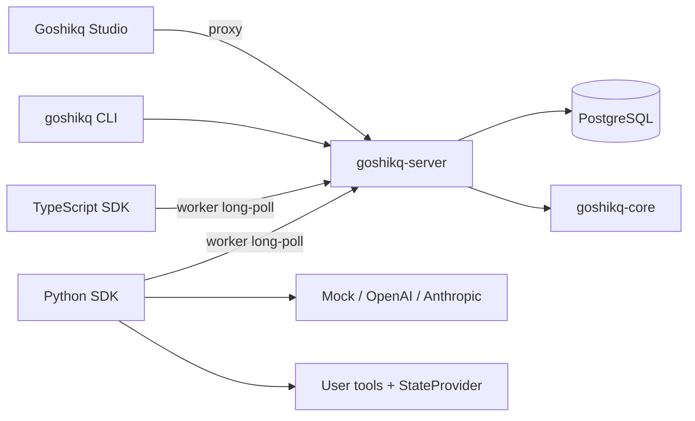
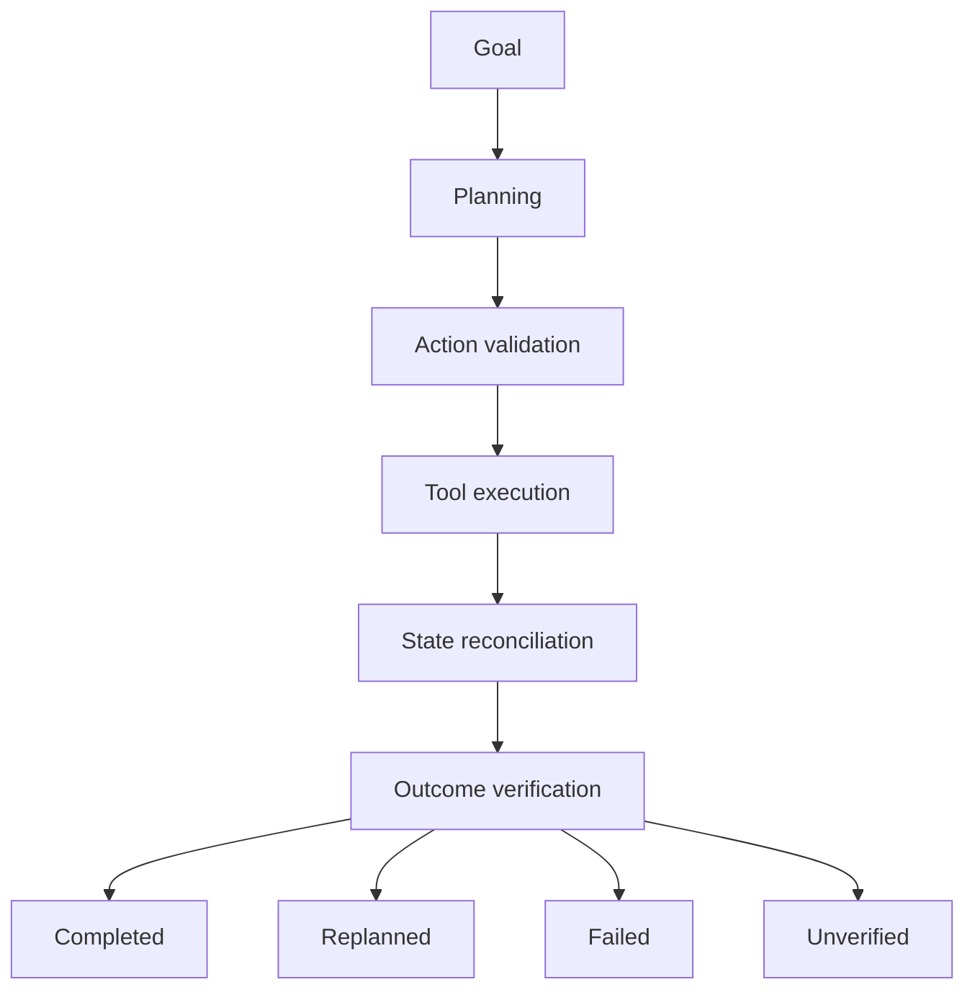
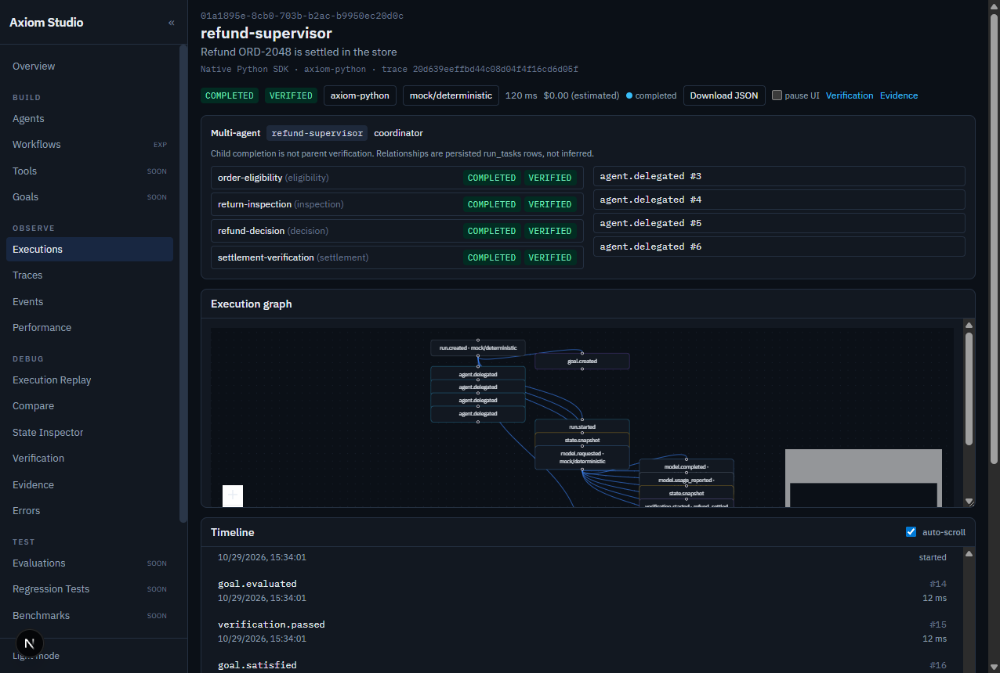
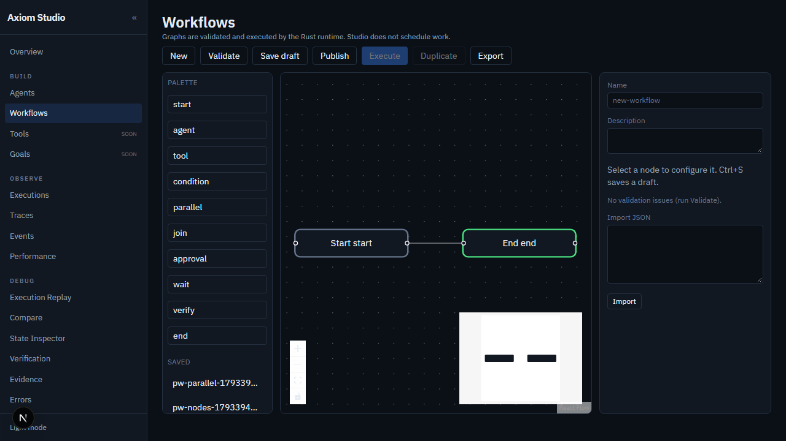
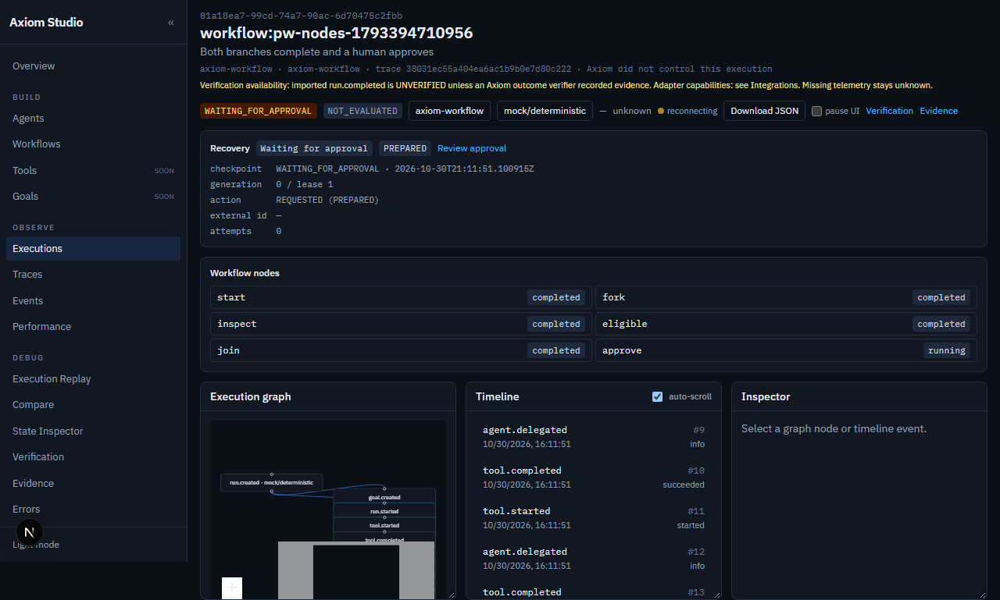

# Goshikq — Outcome-Driven AI Agent Framework Where AI Actions Become Verified Outcomes.
Goshikq is an open-source framework for building, executing, observing, and verifying AI agents. It combines a Rust execution runtime, goal and action contracts, a Python SDK (and a TypeScript client), and **Goshikq Studio**, a developer console for executions—not a chatbot.

**Build Agents. Verify Outcomes.**

Open-source AI agent execution and verification framework. Source repository (name unchanged): [goshikavs/axiom-agent-framework](https://github.com/goshikavs/axiom-agent-framework).

**Status:** `0.1.0-alpha` (**v0.9.1** in tree). APIs will change. This is **not** a published v1.0: packages and GitHub Releases are unpublished. Private CI on `main` is green (Rust, SDKs, Studio, docs, Postgres integration, Playwright, Docker smoke, gitleaks, cargo-audit, pip-audit) at `e7d5b70`. Not SOC 2 / HIPAA / PCI certified.

- Languages: Rust (runtime), Python 3.11+ (SDK), TypeScript (Studio + native SDK worker)
- Runtime: `goshikq-server` on `http://127.0.0.1:7400`
- Studio: Next.js on `http://127.0.0.1:3000`
- Docs: [`docs/`](docs/) · Architecture: [`docs/ARCHITECTURE.md`](docs/ARCHITECTURE.md) · Status: [`docs/IMPLEMENTATION_STATUS.md`](docs/IMPLEMENTATION_STATUS.md)
- Maintainer: [goshikavs](https://github.com/goshikavs)

## Why Goshikq?

Existing frameworks already provide orchestration, retries, tracing, and checkpoints. Goshikq’s intended difference is the *combination* of:

1. First-class goal contracts evaluated against authoritative state
2. Action-effect contracts that drive retry safety
3. Explicit proposed / accepted / completed tool lifecycle
4. A framework-neutral execution event protocol
5. Studio that correlates intent, execution, snapshots, and verification evidence

Goshikq does **not** claim to invent tracing, durable workflows, or verification. It does **not** publish benchmark numbers in this alpha.

## Core features

| Feature | Description | Status | Docs |
| --- | --- | --- | --- |
| Native execution loop | Bounded plan → validate → execute → reconcile → verify | Available | [docs/ARCHITECTURE.md](docs/ARCHITECTURE.md) |
| Mock model | Deterministic offline adapter | Available | [sdk/python](sdk/python/README.md) |
| Goal verification | Predicates on `StateSnapshot` | Available | examples below |
| Event persistence + SSE | Protocol 1.0, idempotent ingest, live Studio | Available | [ADR-002](docs/decisions/ADR-002-execution-protocol.md) |
| Studio explorer | URL-filtered executions, synchronized graph/timeline/inspector, GET-only replay, compare | Available | [docs/studio/overview.md](docs/studio/overview.md) |
| Approvals | Runtime gate + Studio queue | Available | examples/insurance-claims |
| Durable recovery | Checkpoints, action journal, fencing leases, crash harness | Available | [docs/architecture/durable-recovery.md](docs/architecture/durable-recovery.md) |
| Versioned evidence | Explicit evidence records, fingerprints, trust, decision links | Available | [docs/guides/evidence-aware-agents.md](docs/guides/evidence-aware-agents.md) |
| Change-impact / revalidation | Deterministic graph walk; stale approvals cannot authorize writes | Available | [docs/architecture/change-impact-analysis.md](docs/architecture/change-impact-analysis.md) |
| Evidence coverage contracts | Declared requirements + risk gates; completeness ≠ hidden-dep detection | Available | [docs/architecture/evidence-coverage-contracts.md](docs/architecture/evidence-coverage-contracts.md) |
| OpenAI / Anthropic | Provider adapters | Experimental | [sdk/python](sdk/python/README.md) |
| TypeScript SDK worker | Full execution from Bun/Node via the Rust worker protocol | Available | [docs/guides/typescript-sdk.md](docs/guides/typescript-sdk.md) |
| OTLP / LangGraph / OpenAI Agents | HTTP/protobuf ingest + examples; Goshikq does not control those runtimes | Available | [docs/architecture/otlp-ingestion.md](docs/architecture/otlp-ingestion.md) |
| MCP | Allowlisted MCP tools; stdio NDJSON compatible with `@modelcontextprotocol/sdk` 1.32.2 initialize | Available (stdio subset) | [docs/integrations/mcp.md](docs/integrations/mcp.md) |
| Multi-agent | Parent/child runs, verified delegation, shared context | Available | [docs/architecture/multi-agent.md](docs/architecture/multi-agent.md) |
| A2A | Protocol 1.0 JSON-RPC subset; remote SUCCESS ≠ VERIFIED | Available | [docs/integrations/a2a.md](docs/integrations/a2a.md) |
| Workflows | Versioned graphs executed by the Rust runtime; Studio React Flow editor | Available | [docs/architecture/workflow-execution.md](docs/architecture/workflow-execution.md) |
| Production auth | OIDC JWT + JWKS (RS256) + API keys, RBAC, tenant isolation | Available | [docs/security/authentication.md](docs/security/authentication.md) |
| Registered workflow tools | TOOL nodes dispatch through the worker protocol | Available | [docs/architecture/workflow-execution.md](docs/architecture/workflow-execution.md) |
| Runtime OTLP export | Redacted JSON OTLP/HTTP of Goshikq spans; inbound ingest unchanged | Available | [docs/integrations/opentelemetry.md](docs/integrations/opentelemetry.md) |
| Retention | Owner admin purge; automatic sweeper deferred | Available | [docs/operations/retention.md](docs/operations/retention.md) |

## Architecture





## Technology stack

| Piece | Choice | Why |
| --- | --- | --- |
| Runtime | Rust, Tokio, Axum, SQLx | One implementation of transitions, retries, persistence |
| SDK | Python 3.11+, Pydantic, httpx | Where developers define agents and tools |
| Studio | Next.js App Router, React, Tailwind, React Flow, TanStack Query, Monaco, Recharts | Observability console |
| JS tooling | Bun | Package manager and Studio/TS tests |
| Store | PostgreSQL 16 (Compose or embedded Theseus binaries) | Durable runs/events |
| Protocol | Versioned JSON Schema in `protocol/schemas` | Native and future external runs |

OTLP/HTTP (protobuf and JSON) ingestion is available. MCP tools are wrapped with allowlists and Goshikq contracts (protocol **2024-11-05**). A2A protocol **1.0** JSON-RPC (Agent Card, SendMessage, GetTask, CancelTask) is available; remote completion is not parent-goal verification. Temporal is not a dependency. External traces are not verified business outcomes.

### Versions used in development

- Rust 1.98.0 (CI and the runtime Docker image pin this channel; local Windows ARM64 hosts keep using `stable-x86_64-pc-windows-msvc`)
- Python 3.11–3.14
- Bun 1.4+ (CI pins 1.4.4; `bun.lock` is lockfileVersion 2)
- Node is not required if Bun is installed

## Prerequisites

### Windows

- Visual Studio Build Tools with the MSVC x64 toolchain (`link.exe`). On ARM64 Windows, compile the `x86_64-pc-windows-msvc` target: `scripts/with-msvc.ps1 cargo +stable-x86_64-pc-windows-msvc test --workspace`
- Python 3.11+
- Bun (`powershell -c "irm bun.sh/install.ps1 | iex"`)
- Optional: Docker Desktop for Compose Postgres. If Docker is missing, use `DATABASE_URL=embedded`

### macOS / Linux

- Rust (`rustup`), Python 3.11+, Bun, optional Docker

## Quickstart (no paid API keys)

From the repository root:

```bash
# 1. Environment
cp .env.example .env

# 2. PostgreSQL — embedded (default) or Compose
# DATABASE_URL=embedded downloads a local Postgres into .goshikq/postgres
# docker compose up -d postgres   # if you have Docker

# 3. Runtime (Linux/macOS)
cargo run -p goshikq-server

# 3. Runtime (Windows ARM64 / missing link.exe on PATH)
# scripts/dev-server.ps1

# 4. Python SDK
python -m pip install -e sdk/python

# 5. Sample Python agent (mock model; no paid keys)
python examples/hello-agent/main.py
# expect: status COMPLETED  verification VERIFIED

# 6. Sample TypeScript agent (optional; mock model)
bun install
goshikq run examples/typescript-refund-agent
# or: cargo run -p goshikq-cli -- run examples/typescript-refund-agent

# 7. Studio
cd apps/studio && bun install && bun run dev
# open http://127.0.0.1:3000 → Executions → hello-agent → Verification VERIFIED
```

Locate the run under **Executions**. Open it: graph, timeline, inspector, and **Verification** must show `VERIFIED` for the hello-agent happy path.

`goshikq doctor` (after `cargo run -p goshikq-cli` / `cargo install --path apps/cli`) checks runtime reachability without printing secrets.

## Hello World

See [`examples/hello-agent`](examples/hello-agent). Expected fields:

```
status:        COMPLETED
verification:  VERIFIED
```

If the model only *says* Ada was greeted and never calls `record_greeting`, verification does not pass.

## Tool calling

[`examples/tool-agent`](examples/tool-agent) — invalid integer `sku` is rejected by schema validation; a later string call succeeds.

## Goal verification / retail refund

[`examples/retail-refund`](examples/retail-refund) — simulated orders and payment processor.

```bash
python examples/retail-refund/main.py
python examples/retail-refund/main.py --fault processor_reject
python examples/retail-refund/main.py --fault delayed_settlement
python examples/retail-refund/main.py --fault never_settles
python examples/retail-refund/main.py --fault return_changed
```

An `accepted` processor response with `order.status=refund_pending` does **not** verify the goal. The run enters `WAITING_FOR_EXTERNAL_STATE` and polls authoritative state until settlement or `external_wait_seconds`. Verification requires `order.status=refunded` and `refund.status=settled`. See [outcome-verification.md](docs/architecture/outcome-verification.md).

## Insurance claims

[`examples/insurance-claims`](examples/insurance-claims) — payout tool requires human approval in Studio (`/approvals`). `--mutate-policy` changes POL-1 from version 4 to 5 while approval is pending; the old approval cannot authorize the payout. Evidence inspector: `/executions/{id}/evidence`.

## Multi-agent (v0.7)

Child completion is not parent verification. Guide: [docs/guides/multi-agent-development.md](docs/guides/multi-agent-development.md).

```bash
python examples/multi-agent-refund/main.py
python examples/multi-agent-insurance/main.py --mutate-policy
python examples/a2a-collaboration/main.py
```

## TypeScript / Bun

Requires goshikq-server on `:7400` and `bun install` at the repo root.

```bash
bun install
bun test
bun run typecheck
goshikq init --template typescript
goshikq run examples/typescript-refund-agent
goshikq studio
```

The TypeScript process registers tools and a mock model; Rust executes the loop. Happy path: `COMPLETED` / `VERIFIED`. Faults: `GOSHIKQ_REFUND_FAULT=tool_error` and `never_settles`. Guide: [docs/guides/typescript-sdk.md](docs/guides/typescript-sdk.md).

MCP demo: `examples/typescript-mcp-agent` with `examples/mcp-inventory-server`. Descriptions cannot override allowlists. [docs/integrations/mcp.md](docs/integrations/mcp.md).

## Goshikq Studio

Implemented against live API data: Overview, Executions, Execution graph/timeline/inspector, live SSE, Verification, Evidence inspector / dependency graph / change impact, Approvals, Agents, Events, Traces, State inspector, Models, Integrations, Settings, Performance/cost.

Planned pages render an explicit **Planned** state (Tools catalog, Evaluations, Regression, Benchmarks). They are not fake dashboards.

Live hierarchy panel (refund supervisor + four persisted children):



Workflows: Studio → Workflows (React Flow). Graphs execute in Rust after **Publish**. Example: `examples/visual-workflow/parallel-approval.json`.





```bash
goshikq workflows validate examples/visual-workflow/parallel-approval.json
goshikq workflows publish examples/visual-workflow/parallel-approval.json
goshikq workflows run <workflow-id>
```

## Framework interoperability

| Framework | Capability |
| --- | --- |
| Native Goshikq | Full worker protocol |
| Generic HTTP event batch | `POST /api/v1/events/batch` |
| OTLP/HTTP | `POST /v1/traces` protobuf or JSON (`otel-genai-v1`) |
| Native TypeScript | Same worker protocol as Python (`goshikq-typescript`) |
| LangGraph / OpenAI Agents SDK | Examples export OTLP; Goshikq does not control their actions |
| MCP | Stdio/HTTP client; allowlist + schema + permissions (2024-11-05) |
| A2A | Protocol 1.0 JSON-RPC subset; remote SUCCESS ≠ VERIFIED |
| Google ADK, CrewAI, Microsoft Agent Framework | Planned |

## Tests (re-run 2026-10-30, v0.8)

```bash
python -m pytest tests/workflows/test_workflow_execution.py tests/workflows/test_workflow_recovery.py -q
python -m pytest tests/crash/test_crash_boundaries.py -q          # 8 passed
python -m pytest tests/isolation tests/protocol/test_a2a_independent_client.py -q
cd sdk/typescript && bun test                                     # 19 passed including official MCP SDK
cd apps/studio && bunx playwright test                            # 17 passed (13 studio + 4 workflows)
```

Details: [`docs/milestones/v0.8-report.md`](docs/milestones/v0.8-report.md). Docs site: `cd docs/site && bun install && bun run build`.

Lifecycle, recovery, and the five-way outcome contract: [execution-lifecycle.md](docs/architecture/execution-lifecycle.md), [durable-recovery.md](docs/architecture/durable-recovery.md), [action-journal.md](docs/architecture/action-journal.md), [crash-recovery.md](docs/guides/crash-recovery.md), [pending-external-operations.md](docs/guides/pending-external-operations.md).

## API

Runtime: `http://127.0.0.1:7400`

- `GET /health` `GET /ready`
- `POST /api/v1/api-keys` `GET /api/v1/api-keys` (plaintext token shown once)
- `POST /api/v1/runs` (`defer_start`, `parent_run_id`, `task_id`, `correlation_id`) `GET /api/v1/runs/{id}`
- `POST /api/v1/runs/{id}/tasks` `GET /api/v1/runs/{id}/hierarchy` `POST /api/v1/runs/{id}/start` `POST /api/v1/runs/{id}/handoff`
- `PUT/GET /api/v1/runs/{id}/shared-context`
- `GET /.well-known/agent-card.json` `POST /a2a` (A2A 1.0 JSON-RPC)
- `GET /api/v1/runs/{id}/events` `GET /api/v1/runs/{id}/events/stream`
- `GET /api/v1/runs/{id}/verification`
- `GET /api/v1/runs/{id}/recovery`
- `GET /api/v1/metrics/overview`
- `POST /v1/traces` OTLP/HTTP protobuf or JSON (inbound)
- Outbound OTLP: set `GOSHIKQ_OTEL_EXPORTER_OTLP_ENDPOINT`
- `POST /api/v1/admin/retention/purge` (owner; `dry_run` default true)
- `GET /api/v1/openapi.json`

Generate the OpenAPI file: `cargo run -p goshikq-server -- --export-openapi docs/api/openapi.json`

## Platform support

See [`docs/release/platform-matrix.md`](docs/release/platform-matrix.md). Windows x64 is **TESTED**. Linux x64 is **BUILD_ONLY** (CI defined, not yet run). macOS and native ARM64 are **UNSUPPORTED**.

## Known limitations

- v1.0 is **not** ready (`docs/release/v1.0-readiness.md`).
- Docker images exist in-tree; this authoring host has no Docker CLI, so compose smoke is CI-only and has not run.
- GitHub Actions have never executed (no remote, no commits).
- HMAC OIDC is loopback test mode only. Production uses JWKS.
- JWT access tokens cannot be revoked by Goshikq; remove membership or rotate API keys.
- Automatic retention sweeping is deferred; use the owner purge endpoint.
- Quickstart uses `MockModel`. Paid provider keys are optional.

## Deployment

Local development binds loopback and uses `GOSHIKQ_AUTH_MODE=none`. Binding a non-loopback address requires `GOSHIKQ_AUTH_MODE=oidc` or `api_key` (or `GOSHIKQ_ALLOW_INSECURE_BIND=true` on isolated networks). Kubernetes manifests are not provided until they are tested. Compose: `docs/deployment/docker.md`.

## Troubleshooting

| Problem | What to do |
| --- | --- |
| `link.exe not found` | Install VS Build Tools; use `scripts/with-msvc.ps1` and the x64 GNU/MSVC target on ARM64 Windows |
| Python import errors | `pip install -e sdk/python` |
| `bun` missing | Install Bun; on this Windows host it lives in `%USERPROFILE%\.bun\bin` |
| Database connection | `DATABASE_URL=embedded` or Compose; first embedded run downloads Postgres |
| Studio empty | Runtime must be up; Studio proxies `/api/runtime` → `:7400` |
| CORS | Default origins include `http://127.0.0.1:3000` |
| Missing events | Studio fetches `GET /events` then `GET /events/stream?after=<last sequence>`; the server also honors `Last-Event-ID` |
| Port in use | Change `GOSHIKQ_BIND` / Studio `--port` |
| No API keys | Use MockModel; keys are optional |
| TypeScript run not VERIFIED | Confirm goshikq-server is up; tools must attach evidence the way `examples/typescript-refund-agent` does |
| MCP tool ignored | It is not on the allowlist, or schema validation failed |
| Studio origin “External OTLP” | Native TypeScript runs use `source_framework=goshikq-typescript` |

## Performance

TypeScript worker, localhost, mock model (`sdk/typescript/scripts/bench.ts`, 2026-10-29): one-tool verified run **206 ms** including create/poll/snapshots/verify. That is not LLM latency and not a Bun-versus-Python claim. See [`docs/milestones/v0.6-report.md`](docs/milestones/v0.6-report.md).

## Roadmap

See [`docs/IMPLEMENTATION_PLAN.md`](docs/IMPLEMENTATION_PLAN.md).

## Contributing / Security / License

- [CONTRIBUTING.md](CONTRIBUTING.md)
- [SECURITY.md](SECURITY.md)
- [LICENSE](LICENSE) Apache-2.0
- Maintainer: https://github.com/goshikavs
