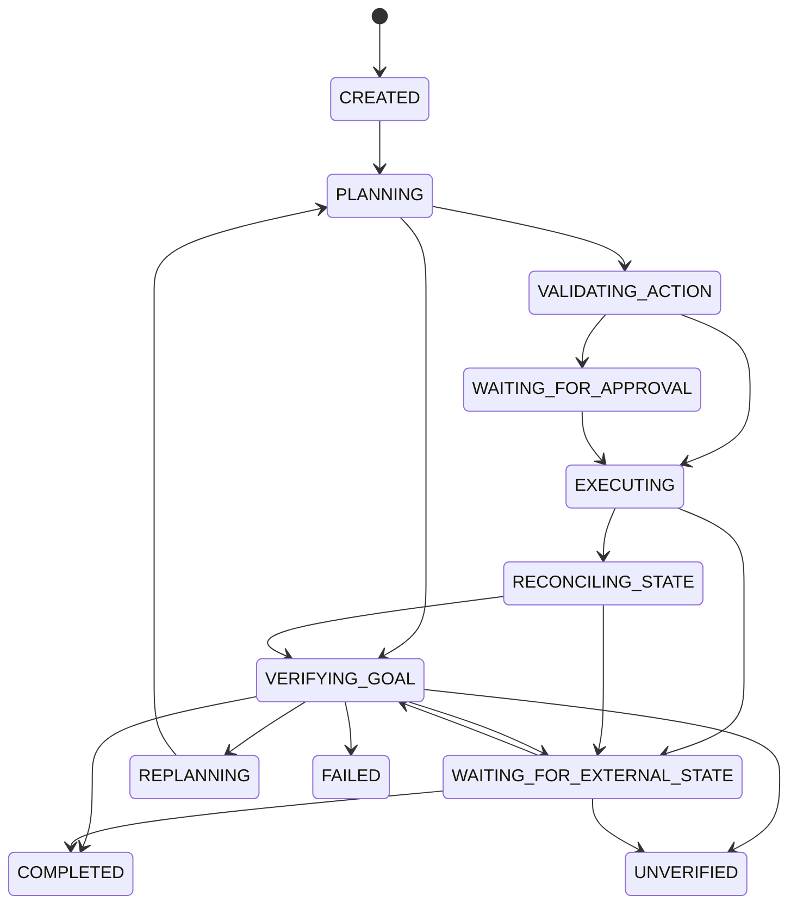

# Goshikq architecture

Goshikq is an open-source AI agent framework. A **model suggestion is never treated as a business result**. The Rust runtime owns durable execution; Python and TypeScript SDKs declare agents, tools, models, and predicates; Goshikq Studio observes persisted events.

## Package graph

```text
sdk/python (goshikq_ai) ──HTTP worker──► crates/goshikq-server ──► crates/goshikq-runtime
sdk/typescript (@goshikq/sdk) ──HTTP inspect/submit──►        │
apps/studio (Next.js) ──proxy /api/runtime──►                  │
apps/cli (goshikq) ──HTTP──►                                     │
                                                               ├── goshikq-core (state machine, action contracts)
                                                               ├── goshikq-protocol (events + worker schemas)
                                                               └── goshikq-storage ──PostgreSQL
```

## Runtime vs SDK

See [ADR-001](decisions/ADR-001-runtime-boundaries.md). After `POST /api/v1/runs` the SDK process long-polls `.../worker/poll` and answers `model.generate`, `tool.execute`, `state.snapshot`, `goal.evaluate`, and `action.verify`. The runtime validates transitions, schemas, permissions, budgets, and verification.

## Execution lifecycle



Lifecycle details: [execution-lifecycle.md](architecture/execution-lifecycle.md) · [recovery-semantics.md](architecture/recovery-semantics.md) · [outcome-verification.md](architecture/outcome-verification.md)

Terminal: `COMPLETED`, `UNVERIFIED`, `FAILED`, `CANCELLED`, `TIMED_OUT`, `BUDGET_EXCEEDED`, `STEP_LIMIT_EXCEEDED`, `MODEL_BUDGET_EXCEEDED`. `UNVERIFIED` means the agent stopped without authoritative proof — not success. `WAITING_FOR_EXTERNAL_STATE` is a durable wait, not a verified outcome.

## Event protocol

See [ADR-002](decisions/ADR-002-execution-protocol.md). JSON Schemas live in `protocol/schemas/`. Ingestion is idempotent on `event_id`. Native runs have monotonic `sequence`. Studio orders by `(timestamp, sequence)` and does not invent missing parents.

## Durability

See [ADR-003](decisions/ADR-003-state-and-recovery.md). PostgreSQL via SQLx. Local development may use `DATABASE_URL=embedded`. Restarted in-flight runs become `RECOVERY_REQUIRED`; nothing is retried automatically. Exactly-once execution of external APIs is not promised.

## Studio

Next.js App Router on `127.0.0.1:3000`. The browser talks only to Studio; Studio proxies `GOSHIKQ_STUDIO_RUNTIME_URL` (default `http://127.0.0.1:7400`). Provider API keys never leave the SDK process.
