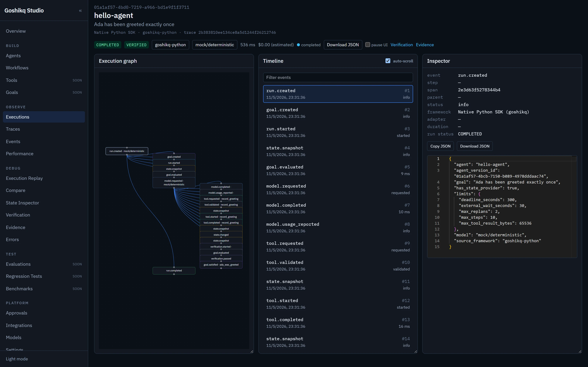

# Execution debugging (three-panel inspector)

URL: `/executions/{id}`

Left: React Flow graph. Center: chronological events. Right: typed inspector.

Selecting a timeline row or graph node sets `selected` to `span_id` (or `event_id`). The other views highlight the same id when it exists. Graph edges are `parent_span_id` only. Time adjacency is not treated as causation. Orphan parents are labeled, not invented.

Traces larger than 250 nodes show the last 250 so the browser stays responsive.

SSE: Studio loads `GET /events` then `EventSource /events/stream?after=<seq>`. Reconnect uses the same `after`. Pause UI queues visual updates only. Copy/download JSON uses payloads already redacted by the runtime.

Non-native frameworks show **Goshikq did not control this execution**. Verification availability is independent of import success.

*hello-agent run with synchronized graph, timeline, and inspector. Status is `COMPLETED` / `VERIFIED`.*
