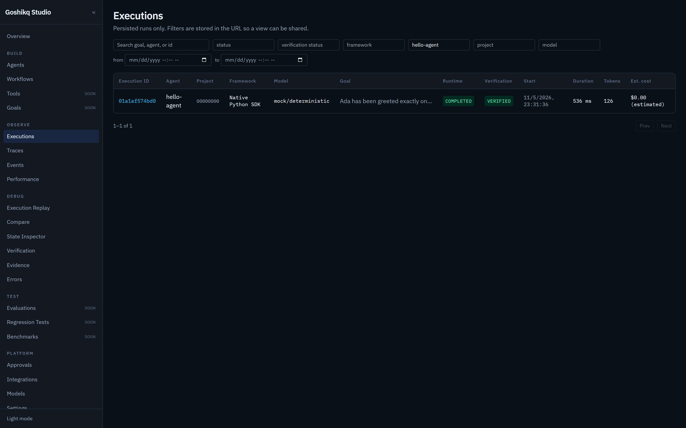
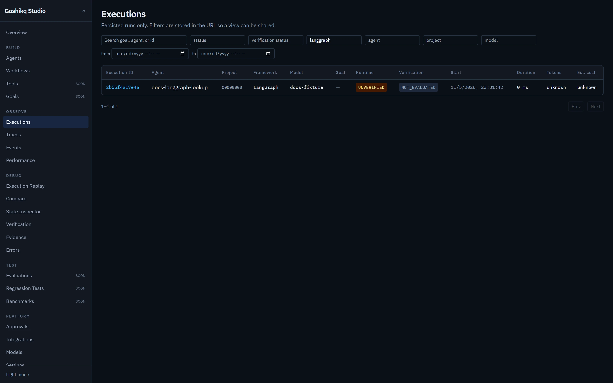

# Execution explorer

URL: `http://127.0.0.1:3000/executions`

The table is `GET /api/v1/runs` with query parameters stored in the address bar.

## Columns

Execution ID, Agent, Project, Source framework, Model, Goal, Runtime status, Verification status, Start time, Duration, Tokens, Estimated cost.

Tokens render as `unknown` unless `usage_known`. Cost renders as `unknown` unless `cost_known`. Missing values are not shown as `$0`.

## Filters and sort

| Query | Meaning |
|---|---|
| `search` | ILIKE on goal, agent name, or run id |
| `status` | runtime status |
| `verification_status` | verification status |
| `framework` | `source_framework` |
| `agent` | `agent_name` |
| `project` | ILIKE on `project_id` (still scoped to the authenticated project; a mismatch yields zero rows) |
| `model` | model |
| `from` / `to` | `created_at` range (ISO) |
| `sort` / `order` | whitelist; default `created_at desc` |
| `offset` | pagination, page size 50 |

*Filtered to `hello-agent`. Native runs can be `VERIFIED` when a state provider satisfies the goal.*

*Imported LangGraph OTLP rows stay `UNVERIFIED` / `NOT_EVALUATED`.*

Imported LangGraph/OpenAI Agents rows stay **UNVERIFIED**. Native hello-agent rows can be **VERIFIED** when a state provider satisfies the goal.
