# Studio

Goshikq Studio is a developer operations console. It reads persisted runs from `goshikq-server` through a Next.js proxy (`/api/runtime`).

Implemented: overview metrics, URL-state execution explorer, execution detail (synchronized graph/timeline/inspector), live SSE with reconnect/pause, verification report, evidence inspector with snapshot diffs, historical replay (GET-only), run comparison, failure analysis, approvals, agents, events, traces, state inspector, models, integrations, settings, cost breakdown, **multi-agent panel** (`GET /api/v1/runs/{id}/hierarchy`, persisted `run_tasks` only).

v0.5 pages: [execution-explorer.md](execution-explorer.md), [execution-debugging.md](execution-debugging.md), [replay.md](replay.md), [run-comparison.md](run-comparison.md). Recaptured Studio screenshots live in [`docs/assets/studio/`](https://github.com/goshikavs/goshikq-agent-framework/tree/main/docs/assets/studio). Regeneration: [studio-screenshots.md](../guides/studio-screenshots.md).

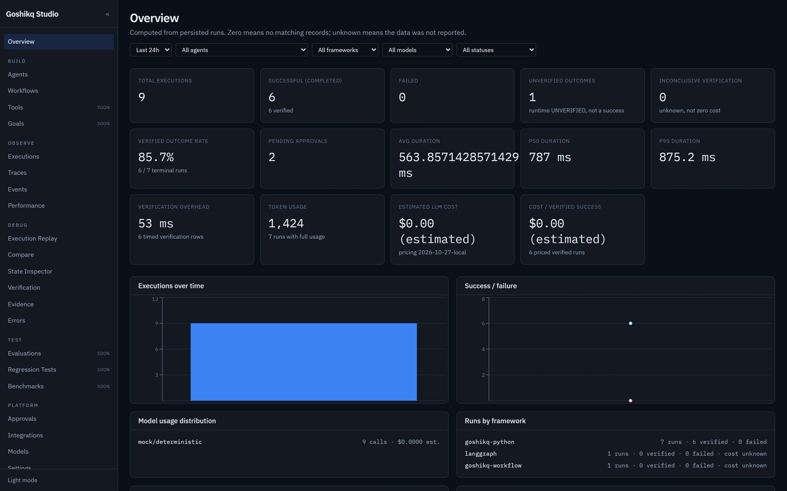
*Persisted overview metrics. Planned nav items stay labeled **soon**.*

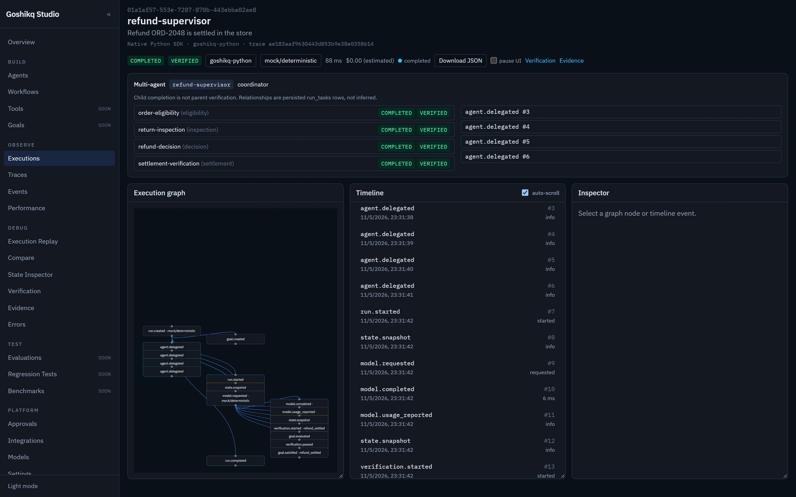
*Parent `refund-supervisor` is `VERIFIED` after four persisted child runs. Child completion is not parent verification.*

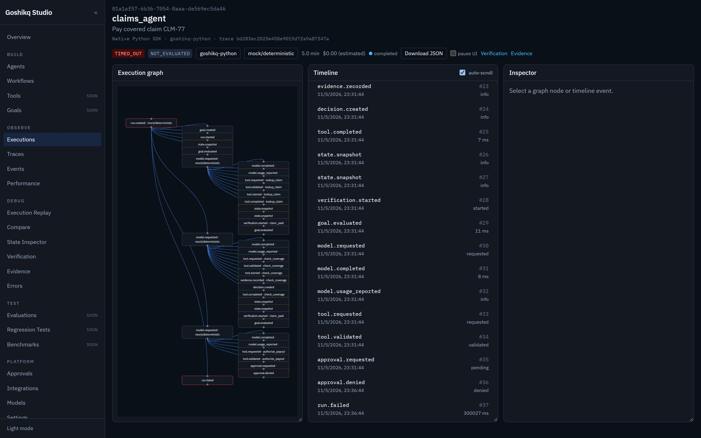
*`claims_agent` paused at `WAITING_FOR_APPROVAL` with a recovery panel. Goal remains `NOT_EVALUATED` until payout is authorized.*

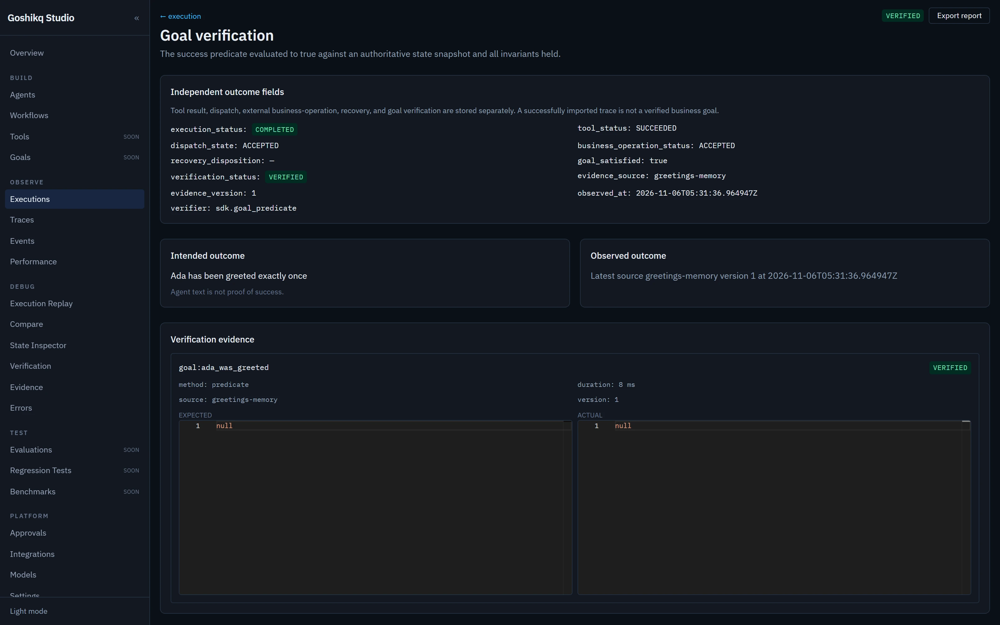
*hello-agent goal verification against persisted `greetings-memory`. Agent text is not treated as proof.*

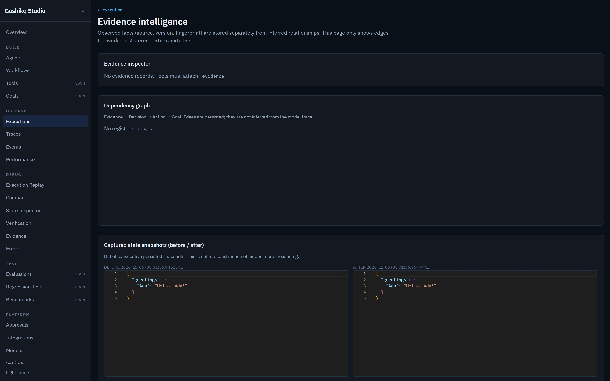
*Snapshot comparison for the same run. Missing `_evidence` rows stay empty instead of being inferred.*

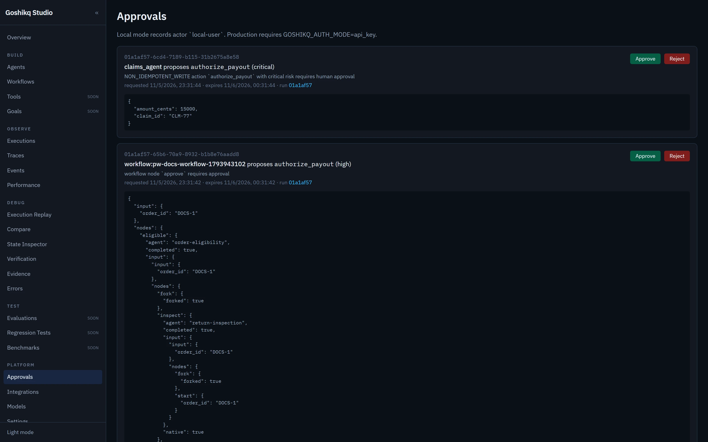
*Pending human approvals from `claims_agent` and a published workflow. Local actor is `local-user`.*

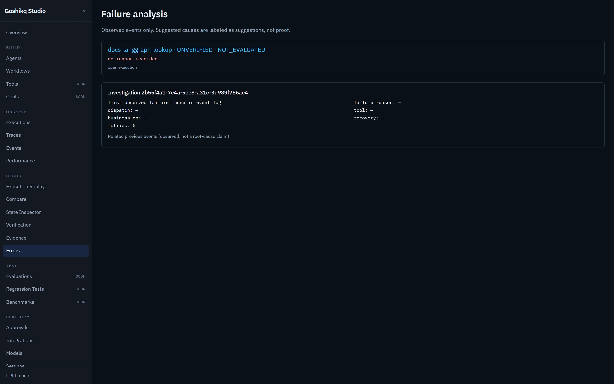
*Imported LangGraph lookup remains `UNVERIFIED` / `NOT_EVALUATED`. Suggested causes are labeled, not proven.*

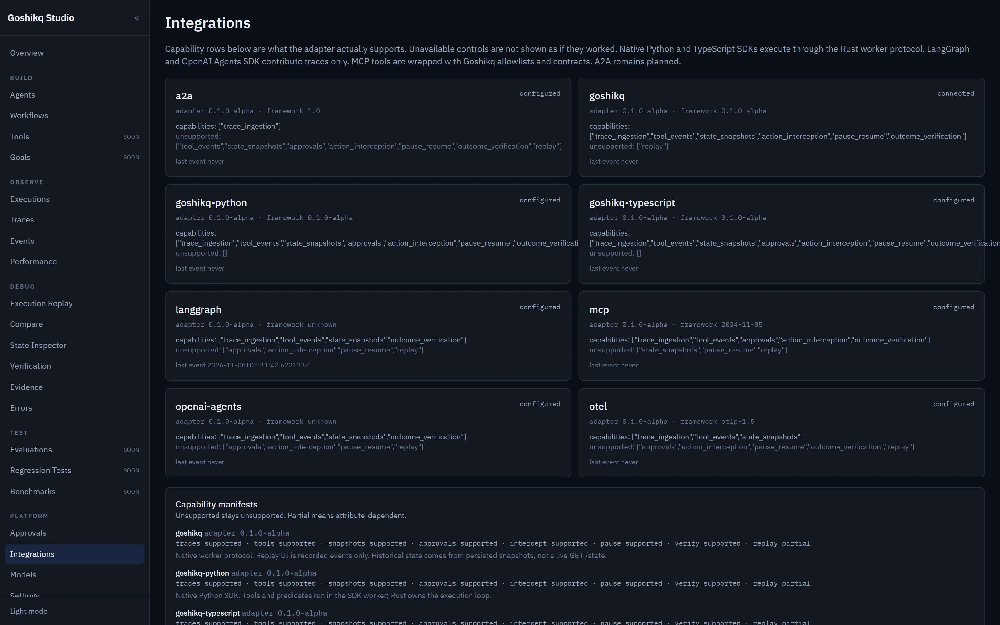
*Adapter capability cards. Unsupported controls are listed as unsupported.*

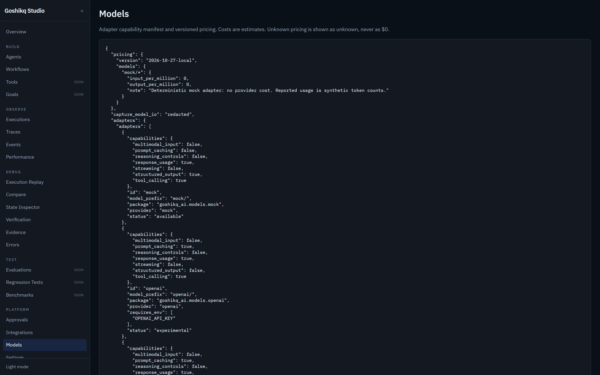
*Mock/deterministic pricing plus adapter capability JSON. Unknown cost is never shown as `$0`.*

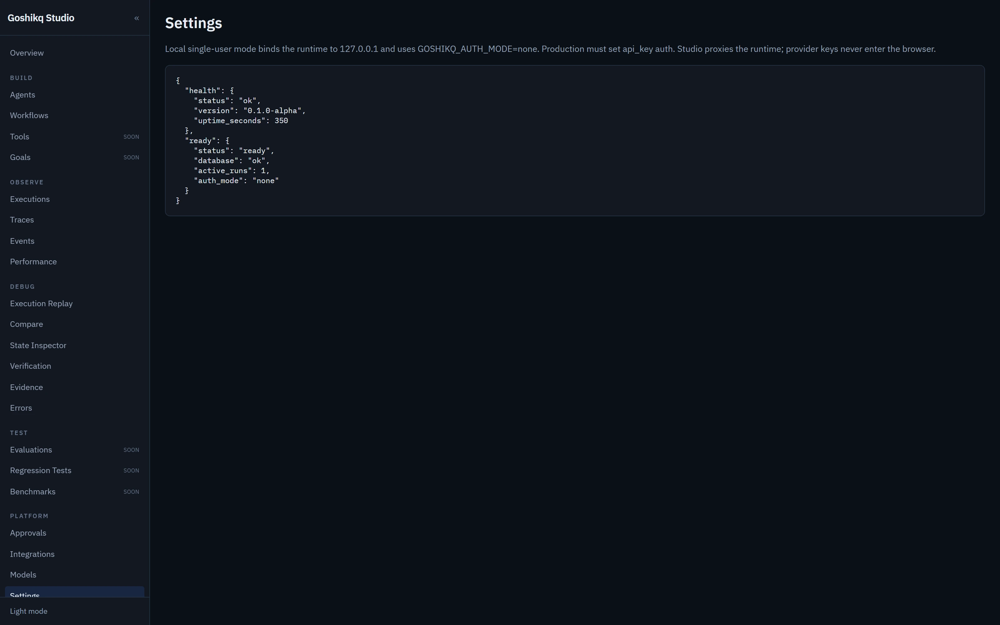
*Local runtime health. Provider keys never enter the browser.*

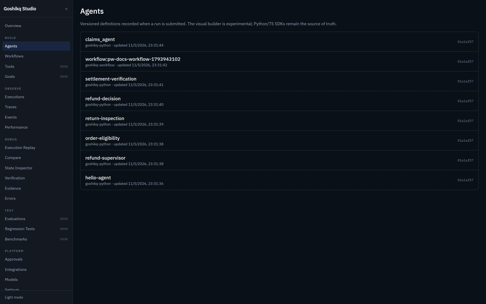
*Versioned agent definitions recorded when runs were submitted.*

Planned pages are labeled **Planned** and do not call fake APIs.

Dev: `cd apps/studio && bun install && bun run dev` → http://127.0.0.1:3000
Playwright: `bunx playwright test` with Studio already on :3000 (`PLAYWRIGHT_SKIP_WEBSERVER=1`).
